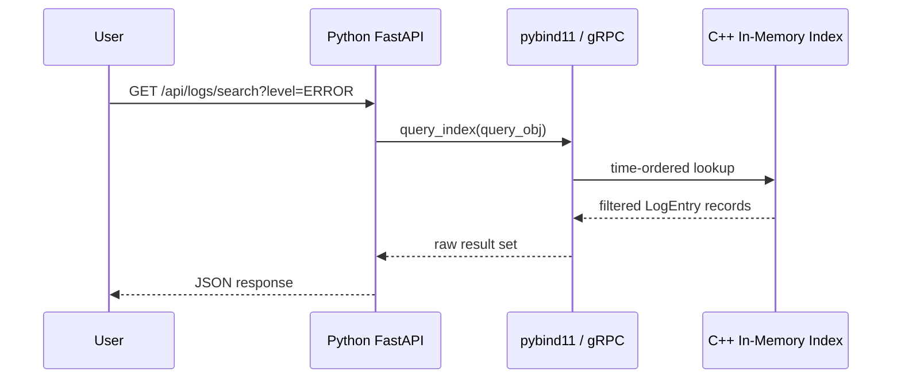

# Pull Request (PR) Writing Guidelines — Log Analyzer

> **Applies to:** All PRs, release branches, and feature merges across the repository (C++, Python, TypeScript).
> **Related Documents:**
> - [`GITFLOW.md`](./GITFLOW.md) — Branching & version control
> - [`code-complexity-and-quality.md`](./code-complexity-and-quality.md) — Code quality standards
> - [`PROJECT_ARCHITECTURE_SAD.md`](./PROJECT_ARCHITECTURE_SAD.md) — System architecture

---

## 1. Core Philosophy

- **Zero Fluff:** Skip all preambles, introductory filler, and conversational pleasantries.
- **Visuals & Trees Over Walls of Prose:** Humans scan PRs visually. Use diagrams, call trees, component hierarchies, or diff-sketches instead of long paragraphs.
- **Concrete Evidence:** Assertions like "it works" or "it compiles" are insufficient. Provide before-and-after proof (build logs, test output, benchmark results).
- **Explicit Risk Analysis:** Every PR must evaluate reversibility ("Door") and potential impact ("Blast Radius").
- **Performance Evidence:** For C++ core changes, include benchmark data (ingestion throughput, index query latency, memory usage). For Python API changes, include endpoint response times.

---

## 2. Standard PR Template

Every pull request description must adhere strictly to this template:

```markdown
## Summary
<diagram, diff-sketch, component tree, or call tree>

## Evidence
- **Before:** <screenshot / terminal output / failing test run / benchmark data>
- **After:** <screenshot / terminal output / passing test run / benchmark data>

## Merge Danger
- **Door:** <one-way or two-way> <optional: explanation if one-way>
- **Blast Radius:** <scope keyword> <optional: potential ramifications of merge>
```

---

## 3. Section Specifications

### 3.1 Summary

Pick the **smallest visual view** that conveys the key architectural or code point clearly:

#### A. Logic or Algorithm → Pseudocode
```cpp
on(ingestLogLine)
  if line.empty() || !isValidFormat(line)
    return reject
  entry = parseLine(line)
  indexWriter.write(entry)
  return accept
```

#### B. Runtime Control Flow → Call Tree
```
searchLogsAPI
  validateSearchParams (Pydantic)
    queryIndexBinding (pybind11/gRPC)
      InMemoryIndex.query
        timeRangeLookup
        levelFilter
        serviceFilter
    serializeResults
```

#### C. UI Structure → Component Tree
```
<LogViewerPage>
  <LogTable>
    <LogRow>
  <FilterBar>
  <Pagination>
```

#### D. File Responsibility or Broad Refactor → Shallow File Tree
```text
src/cpp/
├── index/           # In-Memory Index data structures
├── parser/          # Log format detection & extraction
├── ingestor/        # File I/O, Kafka publishing
└── bindings/        # pybind11 / gRPC interface to Python

src/python/
├── api/             # FastAPI route handlers
├── services/        # C++ binding orchestration
└── schemas/         # Pydantic request/response models
```

#### E. Component Interaction or Data Flow → Mermaid Diagram


#### F. Targeted Diff
Use a diff sketch when the surrounding shape is familiar and the change itself is the point:
```diff
  // src/cpp/index/LogEntry.h
   struct LogEntry {
     std::string timestamp;
     LogLevel log_level;
     std::string source_file;
+    std::string hostname;  // Added for system context
     std::string message;
   };
```

---

## 3.2 Evidence

Never submit a PR without verifiable proof:

| Tier | Type | Best For | Example |
| :--- | :--- | :--- | :--- |
| **S-Tier** | Before & After Screenshots / GIFs | Visual UI changes, styling, layout | React frontend log table rendering |
| **A-Tier** | Terminal / Test Execution Logs | Logic fixes, C++ parsing, API endpoints | C++ unit tests passing, Python API 200 responses |
| **B-Tier** | Benchmark Data | Performance improvements | Ingestion throughput (logs/sec), query latency (ms) |

- **Before:** Paste screenshot, error log, failing test, or baseline benchmark.
- **After:** Paste clean terminal test run, successful API response, or improved benchmark.

---

## 3.3 Merge Danger

Evaluate risk upfront to help the reviewer determine deployment strategy:

### Door Classification
- **`two-way door`**: Cheap and easy to roll back (e.g., CSS token adjustments, non-breaking UI components, copy edits, adding a non-breaking API field).
- **`one-way door`**: Expensive, destructive, or hard to undo (e.g., changing the `LogEntry` struct, breaking the C++ ↔ Python binding interface, changing Kafka topic schema, destructive database migrations, dropping index structures).

### Blast Radius
State the scope and potential ramifications if the PR contains bugs:
- **Scope Keywords:** `isolated`, `cpp-core-only`, `python-api-only`, `frontend-only`, `binding-interface`, `kafka-schema`, `global`.
- **Ramifications:** e.g., *"If broken, could cause all log ingestion to fail"* or *"If broken, Python API cannot query the C++ index, making all search endpoints return 500."*

---

## 4. C++ Specific PR Requirements

- [ ] Cyclomatic complexity ≤ 6 for every modified function
- [ ] RAII used — no raw `new`/`delete` or raw `char*` buffers
- [ ] Benchmark data included for performance-critical changes
- [ ] Memory safety verified (no dangling references across Python binding boundary)

## 5. Python Specific PR Requirements

- [ ] Pydantic models used for all request/response schemas
- [ ] Input validation before C++ binding invocation
- [ ] Specific exception handling — no broad `except:`
- [ ] HTTP status codes correctly mapped from C++ error codes

## 6. TypeScript/React Specific PR Requirements

- [ ] Declarative page components — logic extracted to handlers/hooks
- [ ] Lookup maps instead of long `switch`/`if-else` chains
- [ ] No `eslint-disable`, `@ts-ignore`, or `@ts-expect-error`
