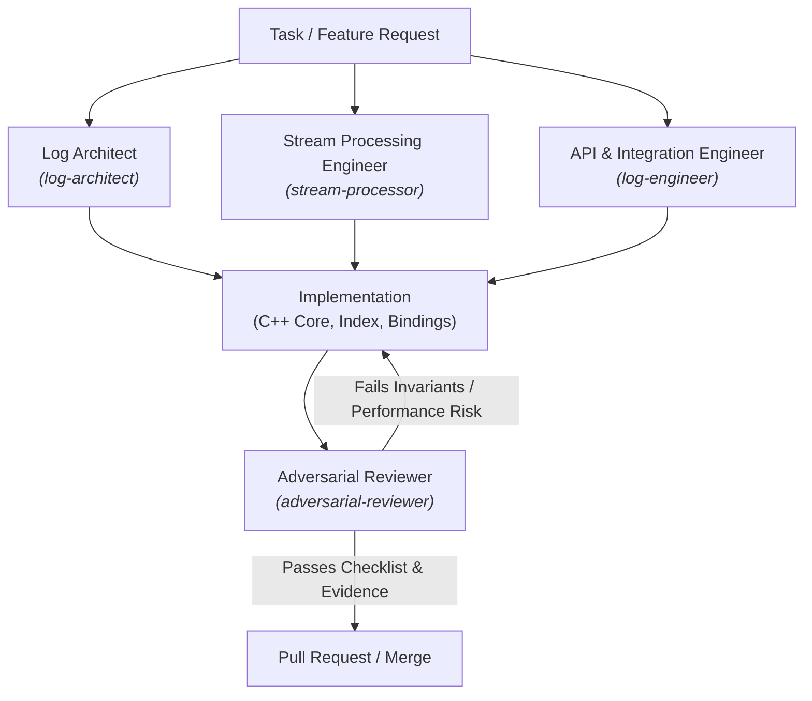

# Specialized Subagent Team: Log Analyzer

> **Applies to:** Multi-agent development workflows, task delegations, and code reviews in the Log Analyzer project.
> **Related Documents:**
> - [`PROJECT_DESIGN.md`](./PROJECT_DESIGN.md) — Product & Domain Specification
> - [`PROJECT_ENGINEERING_SPEC.md`](./PROJECT_ENGINEERING_SPEC.md) — Module & Interface Specification
> - [`PROJECT_ARCHITECTURE_SAD.md`](./PROJECT_ARCHITECTURE_SAD.md) — System Architecture Document
> - [`code-complexity-and-quality.md`](./code-complexity-and-quality.md) — Code Quality & Decomposition Standards

---

## 1. Team Overview & Collaboration Triad

To ensure architectural integrity, performance correctness, and zero-defect code across the polyglot stack (C++ core, Python API, React/TS frontend), this repository employs a **quad of specialized subagents**. Each subagent has a focused mandate and strict evaluation criteria:



---

## 2. Subagent Specifications

### 2.1 The Log Architect (`log-architect`)

- **Invocation Name:** `log-architect`
- **Role:** System architecture, C++ core engine design, In-Memory Index data structures, C++ ↔ Python binding contracts (`pybind11`/gRPC), Kafka topic schema design, and polyglot system decomposition.
- **Tools Granted:** Read, Write/Edit, Command Execution, MCP Tools.
- **Core Responsibilities:**

  1. **PRD & SAD Alignment:** Enforces [`PROJECT_DESIGN.md`](./PROJECT_DESIGN.md) as the absolute source of truth for features, data schema (`LogEntry`), and scope tiers (MVP / v1 / Future). Enforces [`PROJECT_ARCHITECTURE_SAD.md`](./PROJECT_ARCHITECTURE_SAD.md) for component boundaries and data flow state transitions.

  2. **C++ Core Integrity:** Oversees the `LogEntry` C++ struct definition, the layered In-Memory Index structure, and all high-performance parsing/indexing logic. Ensures no CPU-bound work leaks into Python or TypeScript layers.

  3. **Interface Contract Design:** Defines and maintains the exact C++ ↔ Python interface signatures (function names, argument types, return types, error codes). Ensures bindings are strongly typed and versioned.

  4. **Kafka Topic Schema:** Specifies the exact message format for the `raw_logs_topic` (JSON/Protobuf serialization contract) so the C++ producer and C++ consumer agree on the wire format.

  5. **Complexity Ceiling Enforcement:** Actively refactors C++ functions approaching cyclomatic complexity 5. Strictly bans `[[gnu::always_inline]]` hacks or preprocessor abuse used to bypass complexity rules. No `#pragma` complexity bypasses.

  6. **Immutability & Time Ordering Invariants:** Verifies that once a `LogEntry` is written to the In-Memory Index it is never mutated, and that all indexed records within a service/host group are strictly ordered by `timestamp`.

---

### 2.2 Stream Processing Engineer (`stream-processor`)

- **Invocation Name:** `stream-processor`
- **Role:** C++ Ingestion Service and Stream Processor implementation — file I/O, log parsing, Kafka publishing/consuming, normalization, and writing to the In-Memory Index.
- **Tools Granted:** Read, Write/Edit, Command Execution, MCP Tools.
- **Core Responsibilities:**

  1. **Ingestion Pipeline:** Implements the C++ Ingestor that reads raw log files and copied text, parses multiple log formats (syslog, JSON, common web server formats), normalizes them into the canonical `LogEntry` struct, and publishes to Kafka `raw_logs_topic`.

  2. **Stream Processing:** Implements the C++ Stream Processor that consumes Kafka messages, applies enrichment/correlation rules, and writes finalized `LogEntry` records to the layered In-Memory Index.

  3. **Performance & Throughput:** Optimizes for maximum ingestion speed — memory-mapped file I/O, lock-free or low-contention index structures, batch Kafka production/consumption, and zero-copy data transfer where possible.

  4. **Error Resilience:** Handles malformed log lines gracefully (reject-and-log rather than crash), implements backpressure when the In-Memory Index approaches memory limits, and survives Kafka broker restarts.

  5. **Kafka Resilience:** Ensures exactly-once or at-least-once semantics where required, implements retry with exponential backoff for broker connectivity, and preserves message offsets.

---

### 2.3 API & Integration Engineer (`log-engineer`)

- **Invocation Name:** `log-engineer`
- **Role:** Python FastAPI service, REST API endpoints, C++ binding orchestration, query translation, and response serialization for the React/TS frontend.
- **Tools Granted:** Read, Write/Edit, Command Execution, MCP Tools.
- **Core Responsibilities:**

  1. **API Contract Implementation:** Implements the three core endpoints exactly as specified in [`PROJECT_DESIGN.md`](./PROJECT_DESIGN.md):
     - `GET /api/logs/stream` — time-range + optional level/service filtering
     - `GET /api/logs/search` — full-text + field-based filtering
     - `GET /api/dashboard/metrics` — aggregated statistics by time bucket

  2. **C++ Binding Orchestration:** Translates HTTP query parameters into structured C++ query objects, invokes the `pybind11`/gRPC binding layer, and serializes raw C++ result sets into clean JSON for the frontend.

  3. **Request Validation:** Validates all incoming parameters (`start_time`, `end_time`, `log_level`, `service_name`, `query`, `time_range`) before passing them to the C++ core. Rejects malformed or out-of-range requests with 400/422 errors.

  4. **Pagination & Response Shaping:** Implements cursor- or offset-based pagination for large result sets. Ensures JSON responses conform to the `Array<LogEntry>` and metrics schemas without leaking internal C++ memory representations.

  5. **Python ↔ C++ Error Mapping:** Maps C++ error codes/exceptions to appropriate HTTP status codes (e.g., index not found → 404, query timeout → 504).

---

### 2.4 Adversarial Reviewer (`adversarial-reviewer`)

- **Invocation Name:** `adversarial-reviewer`
- **Role:** Independent, skeptical code auditor and PR reviewer. Operates in read-only mode to critique implementations, detect security flaws, verify performance invariants, and challenge risk assessments.
- **Tools Granted:** Read-only (Read File, Run Command, Web Search, MCP Tools; **no write/edit tools**).
- **Core Responsibilities:**

  1. **Security & Boundary Auditing:**
     - Checks every API endpoint for missing input validation or missing parameter sanitization before forwarding to the C++ core.
     - Scans for potential IDOR vulnerabilities in time-range or service-name queries.
     - Confirms no private keys, credentials, or connection strings leak into client bundles or frontend code.

  2. **Performance & Invariant Audit:**
     - Verifies cyclomatic complexity stays ≤ 6 in C++ parsing functions and Python route handlers.
     - Flags any Python-side code that performs CPU-bound parsing or indexing (which should live in C++).
     - Confirms immutability invariant: no code path mutates an indexed `LogEntry`.
     - Confirms time-ordering invariant: index queries return records sorted by `timestamp`.

  3. **Binding & Interface Safety:**
     - Audits `pybind11`/gRPC bindings for memory safety (dangling pointers, buffer over-reads, GIL management).
     - Ensures error codes from C++ are properly caught and translated in Python — no unhandled C++ exceptions crossing the boundary.

  4. **PR Format & Evidence Verification:**
     - Enforces PR template: Summary (diagram/call tree), Evidence (before/after logs/screenshots), Merge Danger (Door + Blast Radius).
     - Rejects assertions lacking proof — performance claims require execution logs or benchmark data.

---

## 3. Workflow & Invocations

When planning or executing work, invoke the appropriate subagent based on the task domain:

```typescript
// 1. Invoking the Log Architect for C++ core, index, or architecture tasks
invoke_subagent({
  TypeName: 'log-architect',
  Role: 'System & C++ Core Architect',
  Prompt: 'Design the C++ LogEntry struct and layered In-Memory Index structure. Define the pybind11 binding interface for Python queries.'
});

// 2. Invoking the Stream Processing Engineer for ingestion/stream tasks
invoke_subagent({
  TypeName: 'stream-processor',
  Role: 'C++ Ingestion & Stream Processing Engineer',
  Prompt: 'Implement the C++ Ingestor that reads raw log files, parses them into LogEntry structs, and publishes to Kafka raw_logs_topic.'
});

// 3. Invoking the API & Integration Engineer for Python API tasks
invoke_subagent({
  TypeName: 'log-engineer',
  Role: 'Python API & Integration Engineer',
  Prompt: 'Implement GET /api/logs/search endpoint with full-text filtering, invoking the C++ binding layer and returning JSON results.'
});

// 4. Invoking the Adversarial Reviewer before finalizing or merging
invoke_subagent({
  TypeName: 'adversarial-reviewer',
  Role: 'Security & Performance Auditor',
  Prompt: 'Audit the C++ binding layer for memory safety and verify Python API input validation before forwarding queries to the C++ core.'
});
```

---

## 4. Cross-Subagent Handoff Protocol

| From → To | Trigger | Deliverable |
| :--- | :--- | :--- |
| `log-architect` → `stream-processor` | Core schema defined | Finalized `LogEntry` struct + Index data structures + Binding interface spec |
| `stream-processor` → `log-architect` | Ingestion complete | Confirmation that Kafka messages match `LogEntry` schema and Index writes succeed |
| `log-architect` → `log-engineer` | Interface ready | C++ binding signatures + query object structure for Python to consume |
| `log-engineer` → `adversarial-reviewer` | API ready for review | Full endpoint implementations with input validation and error mapping |
| `adversarial-reviewer` → All | Review complete | Pass/Fail with evidence checklist and risk classification |
